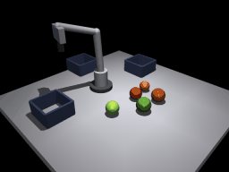
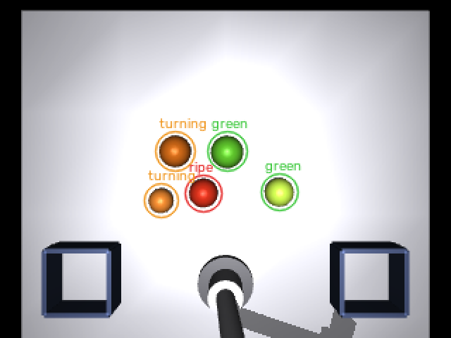

# robot-arm-sorter

A simulated robot arm that sorts tomatoes into ripe, turning and green, built in MuJoCo.
Kinematics, inverse kinematics, trajectory planning, joint control and colour vision are each
written from first principles and checked against the simulator.



*One episode at 4x speed: look, pick the nearest tomato, carry it to the bin for its ripeness,
look again.*

## Why

Smallholder farmers and aggregators in the Ashanti Region of Ghana grade tomatoes by hand into
ripe, turning and green, and the grade sets the price. Grading is slow and inconsistent. This
project asks what a low-cost sorting cell needs, using an arm sized like a cheap hobby-servo arm.
It follows on from Asaase TomGuard, a tomato disease detection robot: that one works in the
field, this one works at harvest.

## Results

On 200 randomised episodes (seeds 6000 to 6199) that played no part in any design choice, each
with 3 to 5 tomatoes of random size, colour and position under random lighting:

| Measure | Target | Result |
|---|---|---|
| Tomatoes in the correct bin | 95% | **99.6%** (781 of 784) |
| Episodes fully sorted | 95% | **98.5%** (197 of 200) |
| Tomatoes put in a wrong bin | | 0 |
| IK position error, 1,000 targets | 1 mm | 1.7e-16 m (closed form), 1e-6 m (numerical) |
| Ripeness grading, 500 renders, harsh lighting | 98% | 100% (1,987 of 1,987) |
| Tomato position error from the camera, harsh lighting | | median 0.3 mm, worst 0.9 mm |
| Throughput | reported | 3.9 tomatoes per simulated minute |

The three losses were all tomatoes dropped onto others in a crowded bin that rolled out
afterwards. Throughput is slow because the motion was tuned for accuracy, not speed.
Every run, with its settings and failures, is in [`experiments/RESULTS.md`](experiments/RESULTS.md).

The ripeness classes come from the colour ranges the scene generator uses, so the grading result
shows robustness to lighting, size and position, not grading of real tomatoes.



## How it works

| Stage | Method | Checked against |
|---|---|---|
| Arm model | Four joints (base yaw, then shoulder, elbow, wrist pitch) and a two-finger gripper, written by hand in MJCF | |
| Forward kinematics | Denavit-Hartenberg parameters | MuJoCo body positions and joint axes, to 1e-9 m |
| Jacobian | Geometric Jacobian | `mj_jacSite` and finite differences |
| Inverse kinematics | Closed form for a top-down grasp (law of cosines), and damped least squares | Each other, on 1,000 targets |
| Trajectories | Quintic joint moves, straight-line Cartesian moves near the tomato | Tool stays on the line to 1e-9 m |
| Control | Joint PID at 500 Hz with gravity compensation from inverse dynamics and anti-windup | Gain sweep |
| Perception | HSV thresholds, connected components, median hue per blob, ray cast from the camera onto the table | Ground-truth positions in 500 scenes |
| Task | State machine: approach, descend, grasp, lift, carry, release, retreat; look again after every pick | 200 + 200 randomised episodes |

Design decisions are recorded in [`docs/decisions/`](docs/decisions/).

## What went wrong along the way

Every real bug and failed idea is in [`docs/LOG.md`](docs/LOG.md). The main ones:

- **The base would not turn.** A body with no joint is welded to the world in MuJoCo, so the
  usual rule that ignores contacts with a parent body did not cover the turret, which rubbed on
  the base plate. Under the same torque the base turned 0.0097 rad before the fix, 0.789 after.
- **The gripper could not hold a tomato.** With MuJoCo's default friction model the tomato slid
  out during the lift. Elliptic friction cones, `impratio` 10 and stiffer finger constraints fixed
  it; the sweep is in the results.
- **Detections were 1.5 mm off in both axes.** A half-pixel convention error, found because the
  bias did not depend on position. Median error fell from 2.1 mm to 0.3 mm.
- **Tomatoes bounced out of the bins.** In the first 200 episodes, 14 tomatoes ended up off the
  table while the robot believed every pick had worked. Deeper bins and a lower release fixed it.
  This is why everything is scored against where the tomatoes really are, not what the robot
  thinks.
- **The numerical IK solved only 13% of targets** from a fixed start pose. Turning the base to
  face the target first raised that to 95.6%; a damping sweep then raised it to 99.7%.

## Run it

```bash
python -m venv .venv && . .venv/bin/activate
pip install -e ".[dev,viz]"
pytest                                   # 64 tests, about 10 s

export PYTHONPATH=src MUJOCO_GL=egl      # MUJOCO_GL=osmesa without a GPU
python experiments/ik_benchmark.py       # IK accuracy and damping sweep
python experiments/pid_sweep.py          # control gains
python experiments/hsv_sweep.py          # perception thresholds (about 1 minute)
python experiments/trials.py --episodes 200 --seed0 6000   # held-out trials (about 4 minutes)
python experiments/render_demo.py        # docs/demo.gif and docs/perception.png
```

## Layout

```
assets/arm.xml          the arm, gripper, tray and cameras
src/arm_sorter/         kinematics, ik, trajectory, control, perception, scene, task, trials, viz
tests/                  unit and integration tests
experiments/            every experiment script and RESULTS.md
docs/                   decisions, engineering log, demo media
```

## Limitations

- Simulation only. Masses, motor limits and friction are estimates sized to hobby servos, not
  measured from hardware, and the simulator has no sensor noise or delay.
- Four joints can only point the gripper within the vertical plane through the base: fine for
  picking round fruit from above, not a general manipulator.
- Colour thresholds suit the simulated tomatoes; real ones would need a labelled image set.
- The robot cannot see a tomato roll out of a bin after release.

## Licence

MIT
